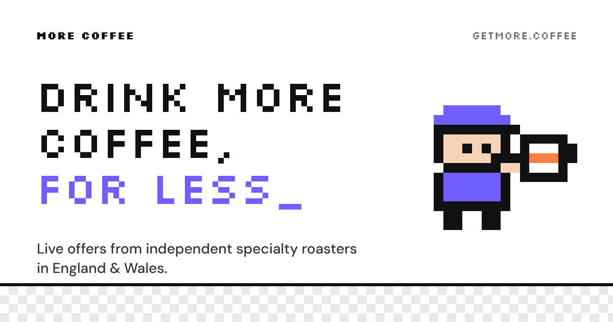

# More Coffee (getmore.coffee)



Live offers from independent specialty coffee roasters in England and Wales. A static front end, serverless functions on Vercel and a Postgres database (Supabase; Neon or any Postgres also works).

## What's in the repo

| Path | What it does |
|---|---|
| `index.html` | The site. Loads deals from `/api/deals`. Opened as a local file, it shows demo data instead. |
| `favicon.svg`, `favicon.png`, `og-image.png` | Icons and the social share image |
| `robots.txt`, `sitemap.xml` | For search engines (`/api/admin` is blocked) |
| `api/deals.js` | `GET /api/deals`: the public JSON, cached at Vercel's edge for 10 minutes |
| `api/cron.js` | The daily scrape, called by Vercel Cron. Does nothing until `AUTO_SCRAPE=true`. |
| `api/admin.js` | Admin actions: set up, scrape, rebuild and more. Replaces the ☕ menu from the Sheets version. |
| `lib/parse.js` | Deal finding and parsing, ported unchanged from the Apps Script version |
| `lib/scrape.js` | The polite scraper: robots.txt, rate limits, back-offs, UK prices in pounds |
| `lib/store.js` | Database reads and writes |
| `lib/brands.js` | Your curated roaster list (36, Ritual included) |
| `lib/config.js` | Settings |
| `db/schema.sql` | Database tables: paste into Supabase's SQL Editor (`lib/schema.js` is the same SQL, bundled for Vercel) |
| `db/seed-roasters.sql` | The curated roaster list as SQL (optional: `?action=setup` adds them too). Safe to re-run. |
| `vercel.json` | Function time limit, the daily cron at 03:00 UTC, headers |
| `test/run.js` | `npm test` |

## Set up on Vercel (about 15 minutes)

1. **Import the repo.** In Vercel, choose **Add New → Project**, pick this GitHub repo and set Framework Preset to **Other**. No build command is needed.
2. **Create the database in Supabase:**
   1. At supabase.com, click **New project**. Pick the **London (eu-west-2)** region and save the database password somewhere safe.
   2. Create the tables: open **SQL Editor → New query**, paste the whole of `db/schema.sql`, and click **Run**. Then do the same with `db/seed-roasters.sql`, which should show 36 roasters. You can skip both, because `?action=setup` in step 4 does the same.
   3. Copy the connection string: click **Connect** at the top of the project and choose **Transaction pooler** (port **6543**, which suits serverless). Replace `[YOUR-PASSWORD]` with your password.
   4. In Vercel, add it as the environment variable `DATABASE_URL`.
3. **Add environment variables** (Settings → Environment Variables). See `.env.example`:
   - `CRON_SECRET`: a long random string (Vercel Cron sends it automatically)
   - `ADMIN_KEY`: a different long random string, for the admin actions
   - `AUTO_SCRAPE`: `false` for now. Daily scraping stays paused until you change it.
4. **Deploy**, then create the tables (if you skipped the SQL Editor) and add the 36 roasters by opening this once:
   `https://getmore.coffee/api/admin?action=setup&key=YOUR_ADMIN_KEY`
5. **Do the first scrape:**
   `https://getmore.coffee/api/admin?action=scrape-now&key=YOUR_ADMIN_KEY`
6. **Point the domain** in Settings → Domains: add `getmore.coffee` and follow the DNS steps.

Using `?key=` in the address bar is fine for quick jobs. For anything scripted, send the key as a header instead:
`curl -H "Authorization: Bearer YOUR_ADMIN_KEY" "https://getmore.coffee/api/admin?action=status"`

## Admin actions (`/api/admin?action=…`)

| Action | Same as the old ☕ menu item |
|---|---|
| `setup` | Set up sheets: creates the tables and seeds roasters (safe to re-run) |
| `scrape-now` | Scrape now: re-checks every active roaster |
| `scrape` | Checks only roasters that are due |
| `scrape-brand&brand=Assembly%20Coffee` | Scrape selected roaster row |
| `remove-expired` | Remove expired deals (also runs after every scrape) |
| `rebuild` | Remove old deals + rebuild |
| `sync-brands` | Sync roaster list from `lib/brands.js` |
| `clear-backoffs` | Clear all back-offs |
| `status` | Every roaster's status and the latest 50 log lines (was the Log tab) |

## Editing data

Use Supabase's **Table Editor**, or any Postgres client.

The tables have Row Level Security switched on with no policies. That blocks Supabase's auto-generated public API, so nobody can read or change your data with the project's public key. The site's server connects with the database password, which isn't affected. Supabase may say the tables have "no policies"; that's intended.

- **Hide a bad deal:** tick `hidden` on that row in `deals`. It stays hidden on later scrapes.
- **Add your own or affiliate deals:** add a row to `manual_deals`. `method` is `code`, `automatic`, `newsletter` or `subscription`. `category` is `coffee`, `equipment`, `other` or `all`. `roast` is optional: `espresso`, `filter` or `omni`.
- **Affiliate tracking:** put the parameter (for example `ref=getmore`) in `brands.affiliate_param`. Every outbound link already carries `utm_source=getmore.coffee`.
- **Change the roaster list:** edit `lib/brands.js`, push, then run `sync-brands`. New roasters are added and removed ones are switched off; nothing is deleted.

## How deals are kept up to date

- **Same deal, same id.** A deal's id comes from the roaster and what the offer is (the code and size of discount, or the product), not the exact banner wording. A deal that's still running is recognised on the next scrape: it keeps its `first_seen` date and isn't counted as new. Each roaster's `status` shows the result, for example `ok · 2 new · 5 unchanged · 1 ended`.
- **Ended deals.** A deal that's gone from the roaster's site is deleted on that scrape. Banners that say an offer has already ended are skipped.
- **Clean-up after every scrape** (or `?action=remove-expired`):
  - deletes deals past their expiry date
  - deletes deals not seen for 3 days (`STALE_DAYS`)
  - deletes hidden deals not seen for 30 days (`DELETE_HIDDEN_AFTER_DAYS`); until then they stay hidden if they come back
  - switches off expired `manual_deals` (never deletes them)
- **On the site:** deals first seen in the last 48 hours get a "New" badge. Visitors can **Hide** subscriptions, office & wholesale, newsletter sign-ups and first-order-only deals, and filter by **Roaster**.

## How scraping works

Each roaster is checked at most once a day.

| Setting (`lib/config.js`) | Value | Why |
|---|---|---|
| Daily cron | 03:00 UTC (3am UK in winter, 4am in summer) | Quiet hours. Off until `AUTO_SCRAPE=true`. |
| Requests per roaster | About 2 a day, plus `robots.txt` weekly (cached in the database) | Polite |
| `BATCH_SIZE` | 5 | Only different roasters are fetched at once, never two requests to one site |
| `MIN_GAP_SAME_SITE_MS` | 5 s | The minimum gap between requests to one roaster |
| Crawl-delay | Respected up to 15 s; above that the product feed is skipped | |
| `BACKOFF_DAYS` | 1 → 2 → 4 → 7 → 14 after a 403, 429 or 503 | A `Retry-After` header is also respected |
| `LOCALE_QUERY` | `?country=GB&currency=GBP` | Vercel's servers may be outside the UK. Shops are asked for UK prices, and any shop still answering in another currency is skipped. |

**Time limits:** each function call is limited to 60 seconds (`maxDuration` in `vercel.json`). A call checks one or two batches, then hands the rest to a fresh call (`action=continue`), up to 30 hand-overs. If your Vercel plan allows longer functions, raise `maxDuration` and `RUN_BUDGET_MS` together so more roasters are done per call.

## Turning daily scraping on

Set `AUTO_SCRAPE=true` in the environment variables and redeploy. Hobby plans allow one cron run a day, which is all this needs.

## Local development

```bash
npm install
npx vercel link && npx vercel env pull .env.local   # or copy .env.example to .env.local
npx vercel dev     # http://localhost:3000
npm test                                               # parsing tests
TEST_DATABASE_URL=postgres://… npm test                # + database tests (use a THROWAWAY database: tables are dropped)
```

On `localhost` without a database the page falls back to demo data. The live site never shows demo data: it shows an error message instead.

## Notes

- Price per gram is still worked out behind the scenes to help identify coffee, but it's never shown (`SHOW_PRICE_PER_GRAM: false`).
- Offers that can only be checked at checkout, such as code-less "2 for 1" banners, are left out (`INCLUDE_CHECKOUT_DEALS: false`).
- The deals are drawn by JavaScript, so search engines see the page but not the individual offers. Pre-rendering them into the HTML is the next step if you want them to rank.
